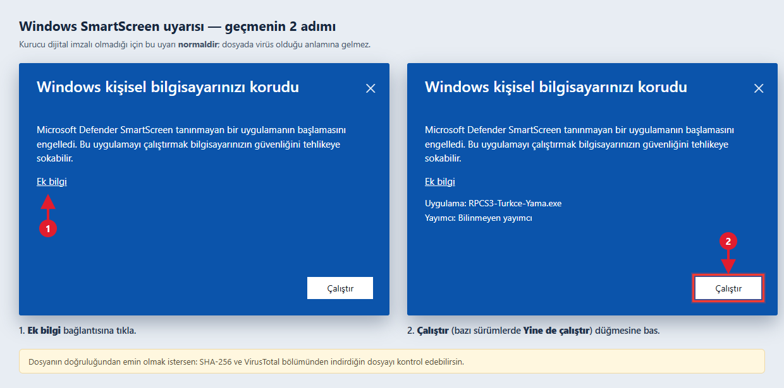

# RPCS3 Türkçe Yama

RPCS3 (PlayStation 3 emülatörü) için Türkçe yama ve tek tıkla kurulum aracı.

**Yapımcı:** menua.gg — Discord: `novacollada`

> **İndirme:** [Releases](https://github.com/menuaGG/rpcs3-turkce-yama/releases) sayfasından en son sürümü indirin.

## Özellikler

- **2.992 metin** Türkçeye çevrildi — arayüz, ayarlar, kupa yöneticisi, RPCN, yama/hile pencereleri, savestate, medya ve daha fazlası
- RPCS3 kurulumunu **otomatik algılama** (birden fazla kurulum varsa seçim listesi)
- Tek tıkla **Kur** ve **Kaldır** (kaldırma, yedekten orijinal dosyalara döndürür)
- Kurulum sonrası RPCS3'ü **otomatik başlatma** seçeneği
- **SHA-256 bütünlük doğrulaması**
- Sürüm uyumluluk uyarısı
- Türk bayraklı özel kurucu simgesi

## Kurulum

1. **Releases** bölümünden `RPCS3-Turkce-Yama.zip` dosyasını indirin.
2. ZIP'i bir klasöre çıkarın ve `RPCS3-Turkce-Yama.exe` dosyasını çalıştırın.
3. RPCS3 klasörünüz otomatik algılanır; gerekirse **Gözat** ile elle seçin.
4. **Kur** butonuna basın.
5. RPCS3'ü yeniden başlatın — arayüz Türkçe olur.

> ⚠️ Kurulum sırasında RPCS3 kapalı olmalıdır; RPCS3 açıkken kurucu sizi uyarır.

## ⚠️ Windows SmartScreen uyarısı (normaldir)

Kurucu dijital imzalı olmadığı için Windows, ilk çalıştırmada "Windows kişisel bilgisayarınızı korudu" uyarısını gösterebilir. Bu uyarı **dosyada virüs olduğu anlamına gelmez** — yeni yayınlanan, imzasız her uygulamada görülür.



1. **Ek bilgi** bağlantısına tıklayın.
2. **Çalıştır** (bazı Windows sürümlerinde **Yine de çalıştır**) düğmesine basın.

## 🔒 Dosya doğrulama (SHA-256 + VirusTotal)

Her sürümün SHA-256 özeti ve VirusTotal tarama bağlantısı burada yayınlanır:

| Sürüm | Dosya | Boyut | SHA-256 | VirusTotal |
| ----- | ----- | ----- | ------- | ---------- |
| v1.1 | `RPCS3-Turkce-Yama.zip` | 290.605 bayt | `896678CC25B974084ADC19C45F2C5692E89C74EE426BF18A42165F61DEAAFC95` | [tarama](https://www.virustotal.com/gui/file/896678cc25b974084adc19c45f2c5692e89c74ee426bf18a42165f61deaafc95) |
| v1.1 | `RPCS3-Turkce-Yama.exe` | 520.192 bayt | `BD24A880479B6C9364BEEBEDA929DEFB470B6495DC50AEDC779255E18EE26B62` | [tarama](https://www.virustotal.com/gui/file/bd24a880479b6c9364beebeda929defb470b6495dc50aedc779255e18ee26b62) |

Windows'ta kontrol etmek için:

```bat
certutil -hashfile RPCS3-Turkce-Yama.exe SHA256
```

Çıkan özet tablodakiyle **birebir aynı** olmalıdır. Uyuşmuyorsa dosyayı silip yalnızca bu depodan yeniden indirin. (ZIP içindeki `RPCS3-Turkce-Yama.exe` dosyası da yukarıdakiyle aynı özete sahiptir.)

> Not: VirusTotal bağlantıları, dosya ilk kez tarandıktan sonra raporu gösterir. Raporlarda Malwarebytes (ML/Anomalous) ve MaxSecure (generic) gibi birkaç sezgisel motor, imzasız ve yeni yayınlanan kurucularda tipik olan **yanlış pozitif** tespit üretebilir; diğer motorlar "Undetected" görünür. Kesin doğrulama yolu SHA-256 eşleşmesidir.

## Bilinen sınırlar

- Geliştirici araçları (debugger, bellek görüntüleyici vb.) ve bazı çevre birimi pencereleri (Wiimote, PS Move, Skylanders) bilinçli olarak İngilizce bırakılmıştır.

## Lisans ve telif

© 2026 novacollada. Bu Türkçe yama **novacollada** tarafından hazırlanmıştır. İzinsiz kopyalanması, yeniden yayınlanması veya ücretli satılması yasaktır. Ayrıntılar için [LICENSE](LICENSE) dosyasına bakın.

Bu proje bir hayran çevirisidir; RPCS3 ekibiyle resmî bağlantısı yoktur.
